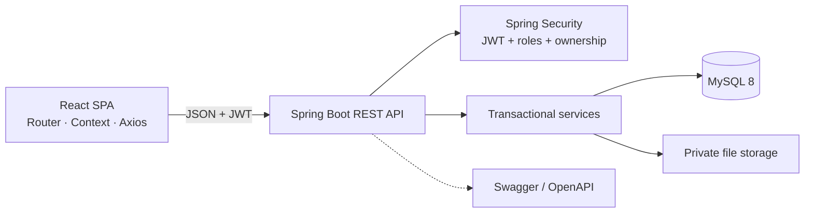
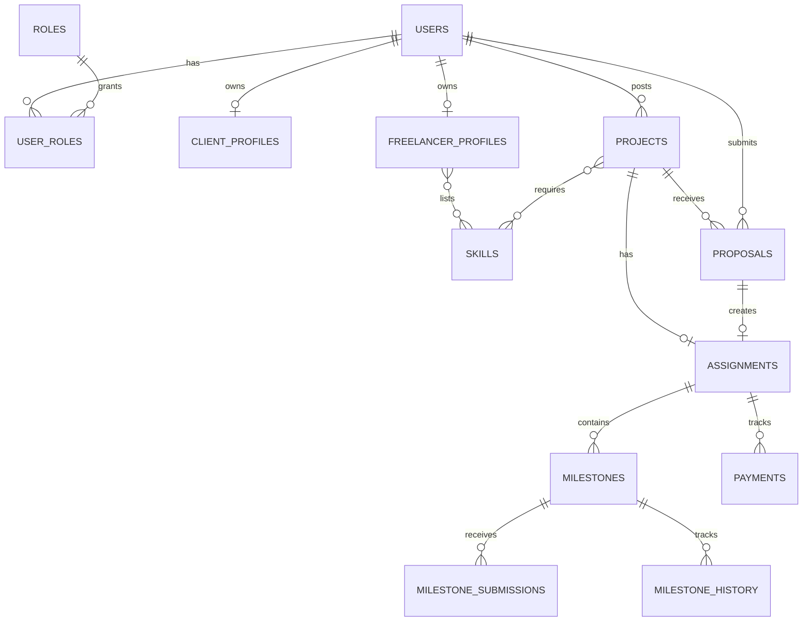

# Architecture and data model

Controllers validate DTOs and delegate to services. Services enforce ownership and workflow rules inside transactions. Repositories persist JPA entities. Flyway owns schema changes; Hibernate runs in validation mode. File metadata is relational, while file contents must be stored outside public application directories.

The complete initial schema, including messaging, notifications, reviews, reports, audit records, and file metadata tables, is in `backend/src/main/resources/db/migration/V1__initial_schema.sql`.

## Security and lifecycle decisions

- Public registration supports CLIENT and FREELANCER accounts.
- Passwords use BCrypt. Access tokens are signed JWTs with a configurable expiry. Each request reloads account state and current roles.
- Proposal acceptance locks the project, creates one assignment, changes project state, and rejects competing pending proposals in the same transaction.
- Milestone status changes are recorded with actor and comment. Approving a milestone creates a PENDING payment record.
- Sandbox payments require a signed HMAC callback before a payment can reach PAID.
- API roles are supplemented by ownership checks at the service layer.
